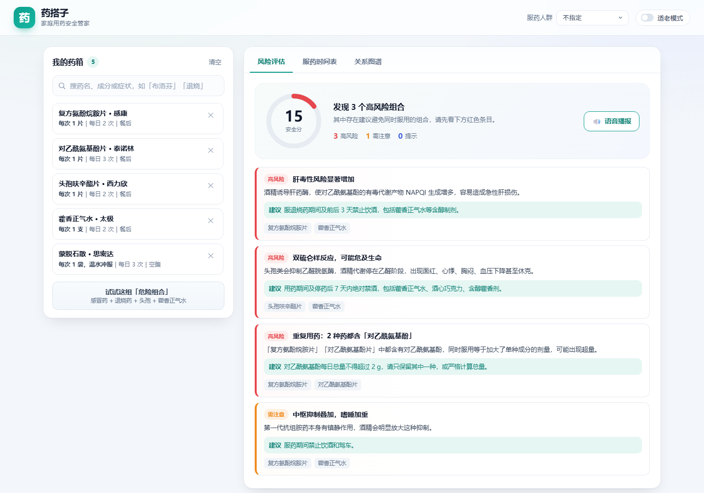
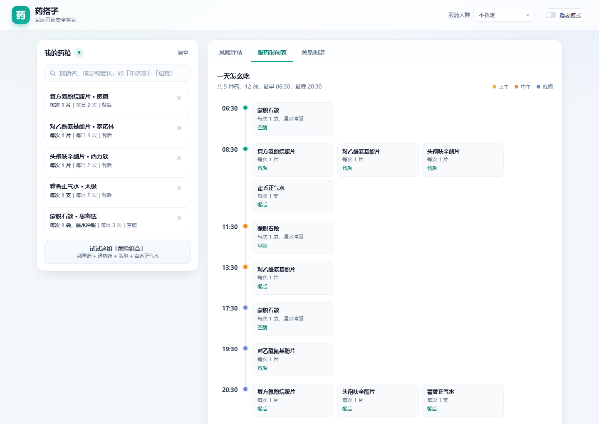
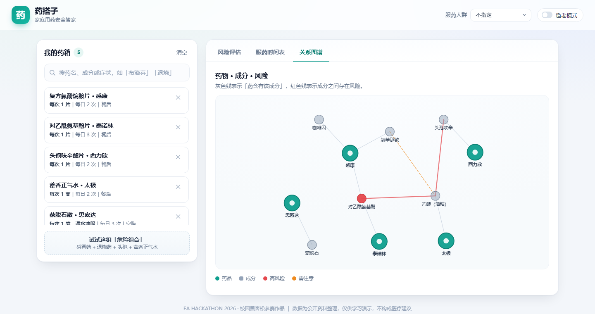

# 药搭子 · 家庭用药安全管家

> EA HACKATHON 2026 ｜ 电子协会首届校园黑客松 ｜ 线上初赛参赛作品
>
> **零依赖 · 零构建 · 不联网**：双击 `index.html` 就能跑。

把家里正在吃的几种药放进去，它会告诉你：哪几种**不能一起吃**、哪个**成分重复**了、一天到底**该怎么排时间**吃——还能用语音把风险念给看不清说明书的老人听。



---

## 一、要解决的问题

感冒了，家里翻出三盒药：感冒灵、泰诺林、还有上次没吃完的复方氨酚烷胺片。三个名字、三种包装，很多人会各冲一包、各吃一片。

但它们的核心成分都是**对乙酰氨基酚**。三份叠在一起就是超量，而超量伤肝——这是临床上很常见的药物性肝损伤原因。

再看一个更隐蔽的：有人中暑喝了藿香正气水，同时又因为嗓子发炎在吃头孢。藿香正气水含 40%–50% 的乙醇，头孢会抑制乙醛脱氢酶，两者相遇就是**双硫仑样反应**：面红、心悸、胸闷、血压下降，严重的会休克。这两样东西单独看都再普通不过，放在一起才要命。

所以我们认为，问题不在"记不住吃药"，而在于三件事：

1. 用户记的是**药名**，风险却发生在**成分**层面；
2. 风险往往不在单个药上，而在**组合**里；
3. 老人看不清说明书上的小字，更需要有人"念"给他听。

---

## 二、核心思路：把「药」拆成「成分」

市面上大多数用药提醒工具管的是"什么时候吃"，我们想管的是"**能不能一起吃**"。

做法是换一个建模的起点——不以药品为中心，而以**成分**为中心：

```
药品（商品名 / 剂型 / 品牌）
   └── 含有 ──> 成分  <── 相互作用 / 重复 / 间隔 ──> 成分
```

这一个改动带来三个直接好处：

| 好处 | 说明 |
| --- | --- |
| 自动识别重复用药 | 不同商品名、相同成分（感康 + 泰诺林）能被自动抓出来，不需要枚举药对 |
| 规则规模从 N² 降到 M² | 31 种药只需维护 25 条「成分 × 成分」关系，新增药品只要标注成分即可接入全部检测 |
| 解释得清 | 界面能明确指出"是哪两个成分出了问题"，而不是笼统地说"这两个药别一起吃" |

---

## 三、功能

| 功能 | 说明 |
| --- | --- |
| **药箱管理** | 按药名、品牌、成分、症状搜索（如搜「退烧」也能出药），支持本地记忆 |
| **重复成分检测** | 多种药含同一成分时给出高风险提示，并说明超量后果 |
| **相互作用检测** | 25 条成分级规则，覆盖出血、双硫仑、肝毒性、横纹肌溶解等 |
| **人群禁忌** | 老年人 / 儿童 / 孕期 / 肝功能不全 / 肾功能不全，切换即重算 |
| **服药时间排程** | 按每日频次排出时间轴，再把"必须间隔 N 小时"的药错开 |
| **适老模式 + 语音播报** | 一键放大字号，并用浏览器语音把风险摘要念出来 |
| **风险关系图谱** | 药品、成分、风险画成一张图，冲突结构一眼可见 |

### 服药时间表

左侧是时间轴，右侧是这一顿要吃的药。蒙脱石散需要和其他药间隔 2 小时，系统会自动把它挪到 06:30 / 11:30 / 17:30，而不是和感冒药挤在一起。



### 风险关系图谱

绿色圆点是药品，灰色圆点是成分，红线是高风险成分对。一眼能看出「头孢呋辛」和「藿香正气水」为什么连在了一起——它们都指向乙醇。



---

## 四、技术实现

整站 **2377 行**，纯原生 HTML/CSS/JavaScript（ES5 语法，classic script），不用框架、不用打包、不用 `npm install`。

```
┌──────────────────────────────────────────────┐
│  index.html        页面骨架                   │
├──────────────────────────────────────────────┤
│  data.js     药品 / 成分 / 相互作用知识库        │  ← 数据层
│  engine.js   ① 风险分析  ② 服药排程            │  ← 算法层
│  graph.js    手写力导向布局 + SVG 渲染          │  ← 可视化层
│  voice.js    Web Speech API 封装               │
│  app.js      状态管理 + 渲染 + 事件             │  ← 交互层
└──────────────────────────────────────────────┘
```

### 4.1 风险分析：四类规则

`engine.analyze(cart, { population })` 把药箱翻译成风险清单：

1. **重复成分**——按成分反向索引所有药，出现 ≥2 次即告警；对乙酰氨基酚、布洛芬、氯苯那敏、咖啡因判为高风险。
2. **相互作用**——两两配对所有成分，命中知识库即生成风险条目。
3. **人群禁忌**——按选定人群的规则表匹配成分。
4. **每日总量**——按单次主成分剂量 × 每日次数，与上限比较（如对乙酰氨基酚上限 2 g/日）。

每条风险都带 `level / title / detail / advice / 涉及药品`，界面直接渲染即可。

安全分算法：`score = 100 - Σ(高风险 25 + 需注意 10 + 提示 4)`，并设 15 分下限，避免"风险一多就显示 0 分"看起来像程序坏了。

### 4.2 服药排程：把间隔要求当成约束来解

这是最有意思的一块。药不是"按时吃"就够，有些药必须**错开**（蒙脱石会吸附其他药，钙/铁会抢左甲状腺素的吸收）。

算法分三步：

```
① 铺点：按每日频次给每剂一个基准时间
   freq=1 → 08:00      freq=2 → 08:00, 20:00
   freq=3 → 08:00, 13:00, 19:00      freq=4 → 08:00, 12:00, 17:00, 22:00
   再按「空腹 / 餐前 / 餐后 / 睡前」做 ±30 分钟偏移

② 收缩：扫描出所有违反间隔要求的剂对，
   把"自带间隔声明"的那一方（蒙脱石、钙剂、铁剂）重新定位——
   在 06:00–23:00 之间以 15 分钟为步长搜索所有合法位置，
   代价 = 偏离原定时间 + 与其他药的拥挤惩罚，取最小代价者

③ 收敛：迭代到没有冲突为止（上限 300 轮）；
   确实排不下的，明确告诉用户"这组间隔无法在同一天内满足"，而不是默默糊过去
```

以「感康 + 泰诺林 + 头孢 + 藿香正气水 + 蒙脱石」为例，最终排出的结果是 7 个时间点、12 剂，且没有残留冲突。

### 4.3 关系图谱：手写力导向

不引入 d3（一个库比整个项目还大）。自己实现三个力：

- **库仑斥力** `F = 14000 / d²`，节点互相推开；
- **胡克弹簧** `F = (d - L) × 0.04`，有边相连的拉近（成分边 L=105，风险边 L=200）；
- **向心引力** + 阻尼，防止飘出画布。

迭代 420 轮后直接输出 SVG，附带边界约束与标签避让。

### 4.4 适老与语音

`speechSynthesis` 走浏览器本地音色，不联网、不花钱。优先挑 `zh-CN` 且 `localService` 的音色，语速降到 0.95；朗读时按钮有呼吸动画，再次点击即可打断。

---

## 五、怎么运行

**方式一（最简单）**：双击 `index.html`，用 Chrome / Edge 打开。

**方式二（推荐，行为更接近真实部署）**：

```bash
# 在项目目录执行
python -m http.server 8080
# 或 Windows 下双击 start.bat
```

然后访问 <http://localhost:8080>。

**快速看演示效果**：打开 `index.html#demo`，会直接载入那组会自动报警的「危险组合」。

---

## 六、自测

`tests/ui-selftest.html` 是一套跑在浏览器里的界面自测：它会真的去点搜索框、点建议、切人群、开适老模式、切标签页，然后断言结果。

```
通过 14 / 14
[PASS] 搜索"布洛芬"能给出建议  (count=2)
[PASS] 点击建议后药箱为 1 种
[PASS] 同一种药不会重复加入
[PASS] 演示组合载入 5 种药
[PASS] 渲染出风险卡片  (total=4)
[PASS] 安全分已计算  (score=15)
[PASS] 时间表渲染出时间点  (rows=7)
[PASS] 切换到老年人后出现人群提示
[PASS] 图谱渲染出节点  (circles=16)
...
```

因为要跨 iframe 读 DOM，需要用支持本地文件互访的方式打开：

```bash
chrome --allow-file-access-from-files tests/ui-selftest.html
```

引擎层另有一组 Node 断言（见 `docs/开发日志.md`），验证规则命中与排程收敛。

---

## 七、目录结构

```
yaodazi/
├── index.html                页面骨架
├── start.bat                 Windows 一键起本地服务
├── assets/
│   ├── css/style.css         设计系统与全部样式（505 行）
│   └── js/
│       ├── data.js           药品知识库：31 药 / 30 成分 / 25 条相互作用（450 行）
│       ├── engine.js         风险分析 + 服药排程（439 行）
│       ├── graph.js          力导向布局 + SVG 渲染（217 行）
│       ├── voice.js          语音播报封装（82 行）
│       └── app.js            状态与交互（525 行）
├── tests/ui-selftest.html    界面自动化自测
├── docs/
│   ├── AI使用说明.md
│   ├── 演示脚本.md
│   ├── 开发日志.md
│   └── images/               README 截图
└── README.md
```

---

## 八、边界与后续

**这个作品目前不做什么**（说清楚比吹得大更重要）：

- 不做诊断、不给处方，只做"组合风险提示"；
- 知识库是 31 种常见药的**教学级**子集，不追求覆盖全部药品；
- 不接医院 HIS，不保存个人健康数据（所有数据只在浏览器本地 `localStorage`）。

**下一步可以怎么长**：

1. 接入国家药监局公开说明书数据，把知识库从 31 种扩到千级；
2. 增加条码/包装识别，扫码即入药箱；
3. 引入服药依从性打卡与家属提醒；
4. 把风险引擎抽成 SDK，供校医院、社区药房的小程序复用。

---

## 九、团队分工

> 参赛形式：团队（2–4 人）【按实际填写姓名与分工】

| 成员 | 分工 |
| --- | --- |
| 【姓名】 | 产品设计、药品知识库整理、答辩 |
| 【姓名】 | 前端实现、交互与视觉 |
| 【姓名】 | 风险引擎与排程算法、测试 |
| 【姓名】 | 演示视频、文档与提交材料 |

---

## 十、AI 工具使用与第三方资源

本项目在开发过程中使用了 **DeepSeek Harness** 等生成式 AI 工具辅助需求梳理、代码生成、调试与文档撰写，
具体到每个环节分别做了什么，记录在 [docs/AI使用说明.md](docs/AI使用说明.md)。

**第三方资源**：

- 图形与布局：全部手写 SVG / CSS，未使用任何图表库或 UI 框架；
- 语音：浏览器原生 Web Speech API；
- 药品数据：依据国家药监局公开说明书要点与常见药学资料整理，**经过简化，非完整说明书**；
- 字体：使用系统字体，未打包字体文件。

本项目**未使用**任何现成的同类产品代码或模板。

---

## 免责声明

本项目为校园黑客松比赛演示作品，药品数据为公开资料整理的教学示例，**不构成任何医疗建议**。
实际用药请遵医嘱，并仔细阅读药品说明书。
